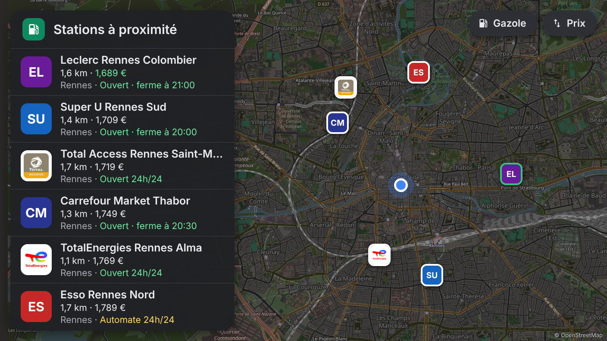
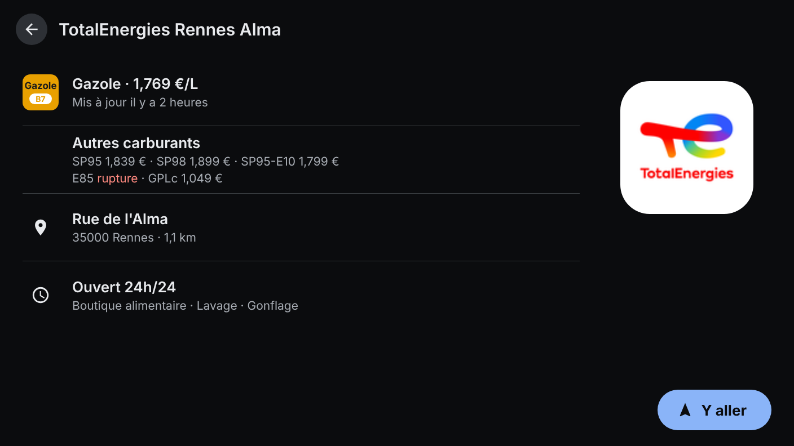
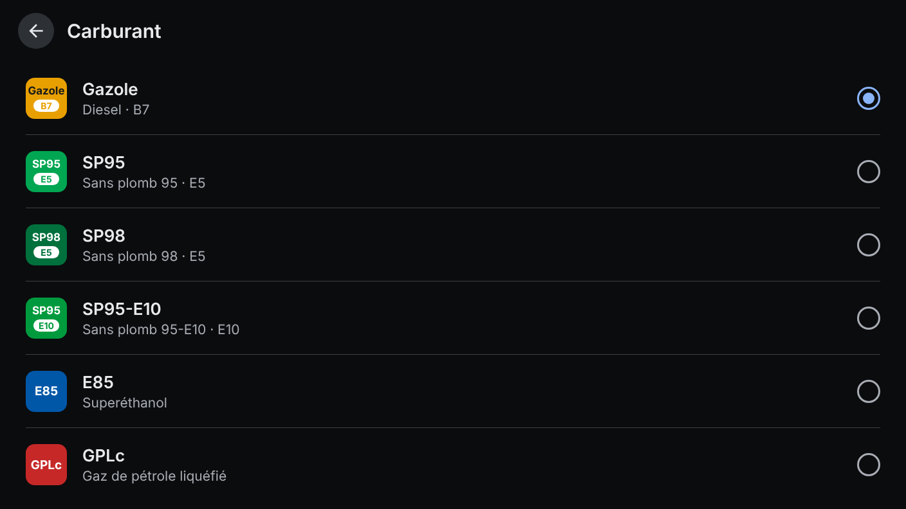

# Carburants — Android Automotive

Nearby fuel stations for **Android Automotive OS 12+** (API 31), built with the
[Car App Library](https://developer.android.com/training/cars/apps) templates (POI category),
so it follows the platform's driving guidelines out of the box.

- Map + list of the nearest stations selling your fuel, cheapest highlighted in green
- Logo, name, price, distance, opening status per station
- Detail: price and freshness, other fuels, address, hours, services, **Go** button that hands
  the destination to the car's navigation app (`CarContext.ACTION_NAVIGATE`)
- Fuel picker (Gazole, SP95, SP98, E10, E85, GPLc) and price / distance sort, both remembered
- Automatic refresh after 2 km or 10 minutes; 10 km radius, widened to 30 km when there are fewer than 3 stations

## Screenshots

| Nearby stations | Station | Fuel |
| --- | --- | --- |
|  |  |  |

Mock-ups of the templates as the car's host draws them (dark theme, 1408 × 792), made with made-up
data by `python scripts/screenshots.py` (Playwright + Pillow, map from the OpenStreetMap tiles in `scripts/tiles`).

## Data

Same sources and logic as [ha-carburants-france](https://github.com/juju35/ha-carburants-france):

| What | Source |
| --- | --- |
| Prices, shortages, hours, services | [Prix des carburants en France – flux instantané v2](https://data.economie.gouv.fr/explore/dataset/prix-des-carburants-en-france-flux-instantane-v2/) (no key) |
| Station names and brands | [Aohzan/hass-prixcarburant](https://github.com/Aohzan/hass-prixcarburant) `stations_name.json` (Apache-2.0), weekly cache |
| Brand fallback | OpenStreetMap via Overpass (`ref:FR:prix-carburants`, else nearest branded station within 300 m) |
| Logos | Wikidata P154 → Wikimedia Commons; TotalEnergies / Total Access shipped with the app |

Lookups to OpenStreetMap and Wikidata are best effort and cached per station.

## Layout

```
app/src/main/java/me/jstephan/carburants/
├── CarburantsService.kt      # CarAppService + Session
├── Prefs.kt                  # fuel, sort
├── data/                     # API client, names file, brands/logos, repository
├── location/                 # LocationManager wrapper
└── ui/                       # list (PlaceListMapTemplate), detail (PaneTemplate), fuel picker, permission
```

## Build and run

```sh
./gradlew assembleDebug
```

Test on an emulator from Android Studio's Device Manager with an **Automotive** system image
(Android 12L / API 32 or later, "with Google APIs/Play"). Debug builds accept any templates host;
release builds only the hosts in the library's allowlist.

On a real car, third-party templated apps are installed through Google Play (internal or closed testing track).

## License

MIT
