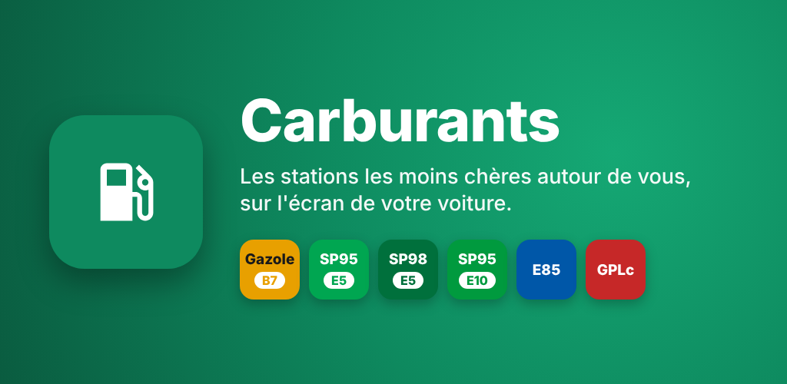
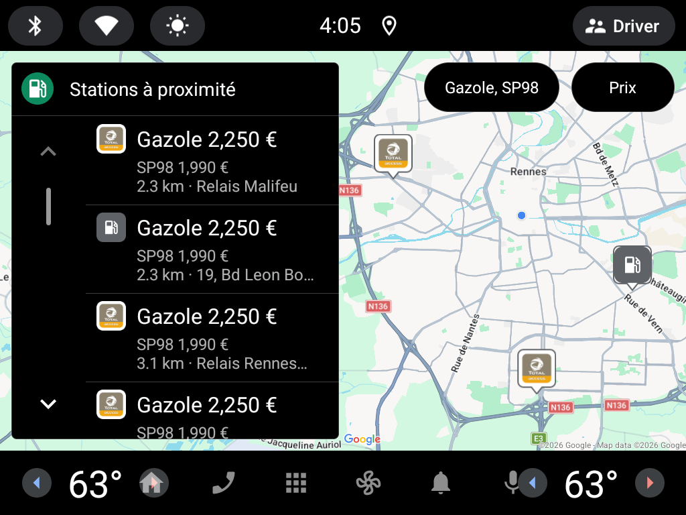
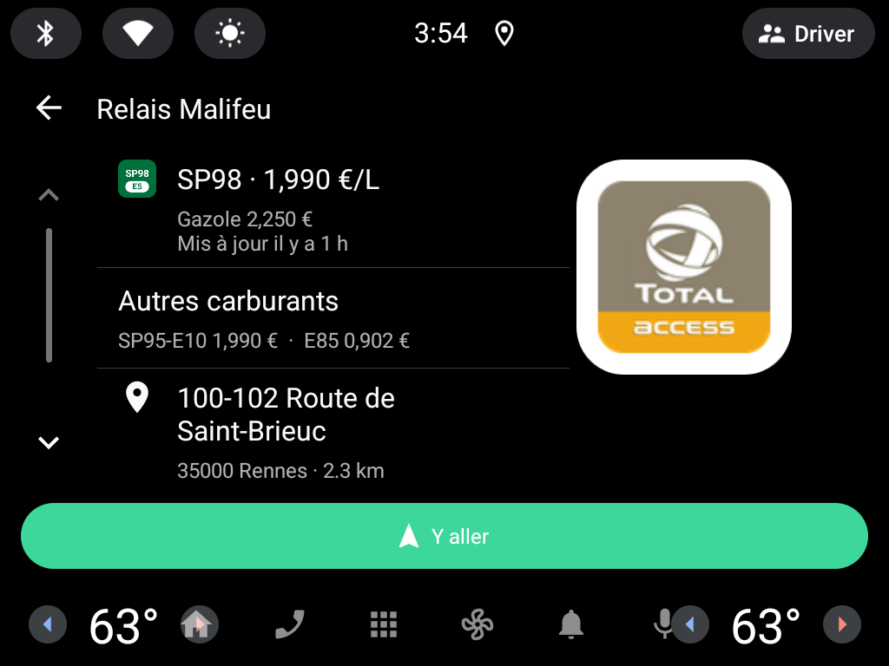
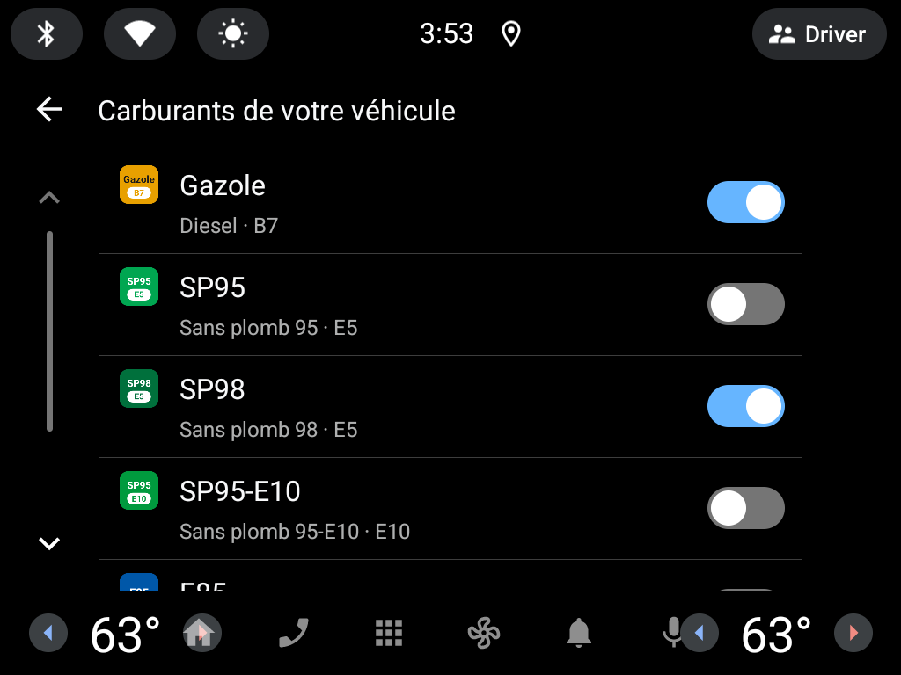
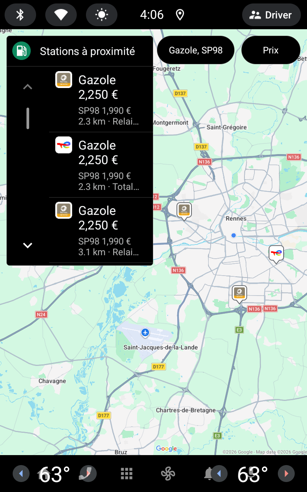
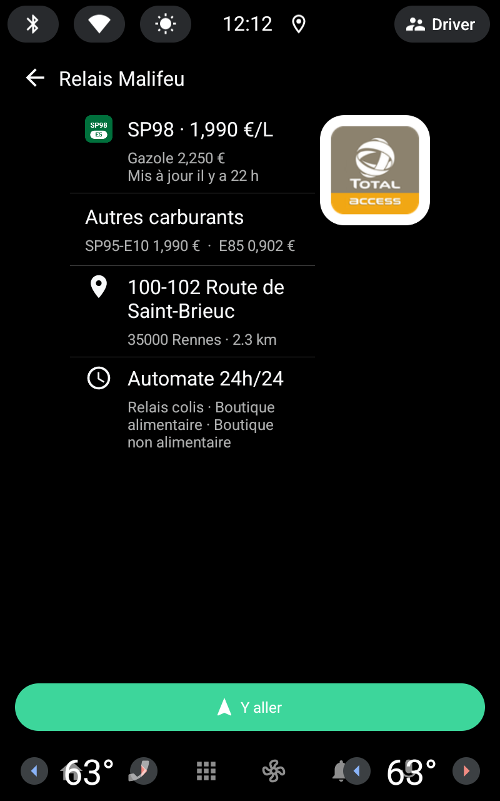
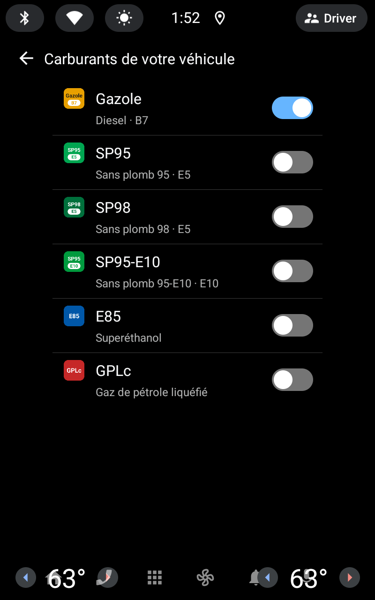
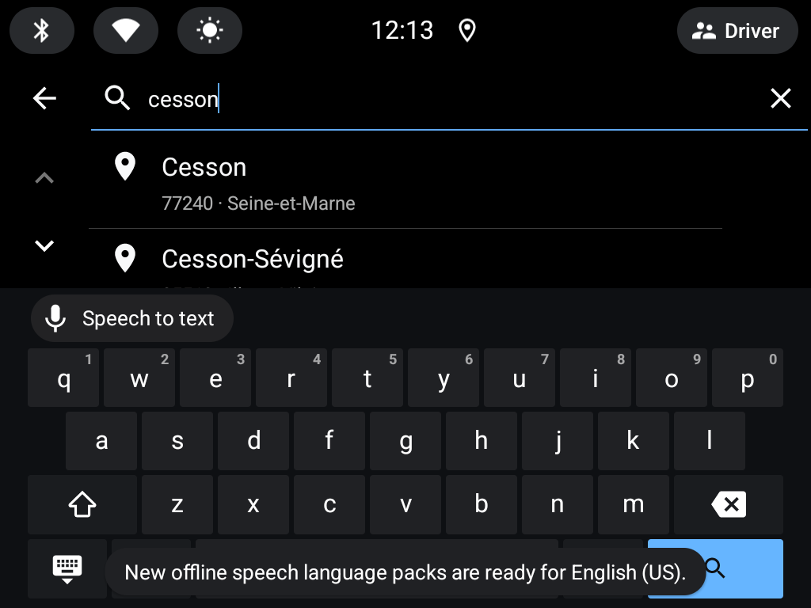
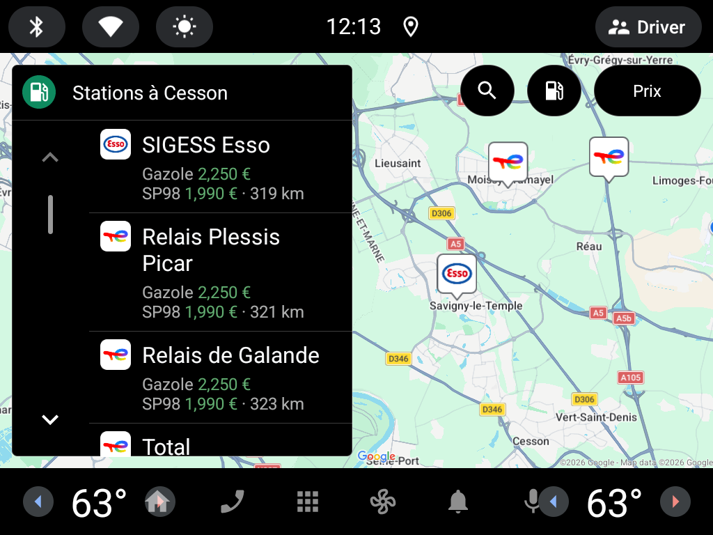
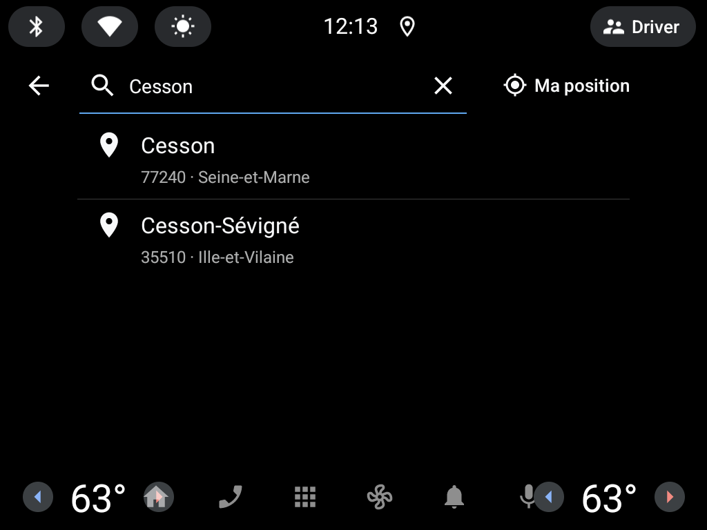

<p align="center"></p>

# Carburants — Android Automotive



Nearby fuel stations for **Android Automotive OS 12+** (API 31), built with the
[Car App Library](https://developer.android.com/training/cars/apps) templates (POI category),
so it follows the platform's driving guidelines out of the box.

- Map + list of the nearest stations selling the fuels your car takes, with the price of each, one per line, the lowest in green; each station marked with its logo on the map
- Logo, name, price, distance, opening status per station
- Detail: your cheapest fuel there and its freshness, your other fuels, the rest, address, hours, services, **Go** button that hands
  the destination to the car's navigation app (`CarContext.ACTION_NAVIGATE`)
- Fuel picker: switch on the fuels your car takes (Gazole, SP95, SP98, E10, E85, GPLc, at least one); the price sort uses
  the cheapest of them at each station. Fuels and sort are remembered
- Automatic refresh after 2 km or 10 minutes; 10 km radius, widened to 30 km when there are fewer than 3 stations
- Town search (name or postcode) with suggestions as you type; the clear button goes back to the stations around the car

## Screenshots

On the Android Automotive emulator (generic image, templates host), Gazole and SP98 followed. These are the
Google Play listing screenshots, refreshed by running the Emulator workflow by hand with *screenshots*.

| Nearby stations | Station | Fuels |
| --- | --- | --- |
|  |  |  |
|  |  |  |

| Town search | Around a town | Search again, clear to go back |
| --- | --- | --- |
|  |  |  |

## Data

Same sources and logic as [ha-carburants-france](https://github.com/juju35/ha-carburants-france):

| What | Source |
| --- | --- |
| Prices, shortages, hours, services | [Prix des carburants en France – flux instantané v2](https://data.economie.gouv.fr/explore/dataset/prix-des-carburants-en-france-flux-instantane-v2/) (no key) |
| Station names and brands | [Aohzan/hass-prixcarburant](https://github.com/Aohzan/hass-prixcarburant) `stations_name.json` (Apache-2.0), weekly cache |
| Brand fallback | OpenStreetMap via Overpass (`ref:FR:prix-carburants`, else nearest branded station within 300 m) |
| Town search | [geo.api.gouv.fr](https://geo.api.gouv.fr/decoupage-administratif/communes) communes (name, postcode, centre), most populated first |
| Brand → Wikidata | OSM `brand:wikidata`, else OSM's [name-suggestion-index](https://github.com/osmlab/name-suggestion-index) (fuel brands, BSD-3-Clause), weekly cache |
| Logos | 42 French networks shipped with the app (`res/raw/brand_logos.json`: Leclerc, Intermarché, Carrefour, U, Total, Esso, Shell, BP, Avia…), else Wikidata P8972 (small logo or icon) / P154, or the parent organisation's, via Wikimedia Commons |

Lookups to OpenStreetMap and Wikidata are best effort and cached per station.

## Layout

```
app/src/main/java/me/jstephan/carburants/
├── CarburantsService.kt      # CarAppService + Session
├── Prefs.kt                  # fuel, sort
├── data/                     # API client, names file, brands/logos, repository
├── location/                 # LocationManager wrapper
└── ui/                       # list (PlaceListMapTemplate), detail (PaneTemplate), fuel picker, permission
```

## Build and run

```sh
./gradlew assembleDebug
```

Test on an emulator from Android Studio's Device Manager with an **Automotive** system image
(Android 12L / API 32 or later, "with Google APIs/Play"). Debug builds accept any templates host;
release builds only the hosts in the library's allowlist.

On a real car, third-party templated apps are installed through Google Play (internal or closed testing track).

## CI

| Workflow | What |
| --- | --- |
| Lint | pre-commit (whitespace, YAML/XML/TOML, Ruff for `scripts/`), Detekt + ktlint (Kotlin quality, dead code), Android lint, jscpd (duplication). Detekt and Android lint findings go to code scanning, shown on pull requests |
| CodeQL | Security and quality queries on the Kotlin code and the workflows; weekly too |
| Build | Debug APK, as a build artifact |
| Emulator | Runs the app on an Android Automotive emulator with the templates host (landscape and portrait) on each app change; fails on a crash or a template the host refuses. Run by hand with *screenshots* to refresh the Play screenshots |
| Release | On `main`, when `appVersion` in `app/build.gradle.kts` has no tag yet: signed APK + App Bundle, notes from `CHANGELOG.md`; upload to Google Play when its secret is set |
| Update release notes | Rewrites a release's notes from `CHANGELOG.md` (input `tag`) |
| Clean up merged branches | Deletes merged branches after each pull request and weekly |
| Stale | Marks and closes inactive issues and pull requests |

Release signing uses the repository secrets `SIGNING_KEYSTORE_BASE64`, `SIGNING_STORE_PASSWORD`,
`SIGNING_KEY_ALIAS` and `SIGNING_KEY_PASSWORD`; without them the release is signed with the debug key
(emulator / adb only, not accepted by Google Play).

## Google Play

Listing texts, graphics, privacy policy and the Play Console answers are in [`play/`](play/README.md).

**Upload key** (once, kept outside the repository; Play App Signing holds the app signing key):

```sh
keytool -genkeypair -v -keystore upload.jks -alias upload -keyalg RSA -keysize 4096 -validity 10000
gh secret set SIGNING_KEYSTORE_BASE64 --body "$(base64 < upload.jks | tr -d '\n')"
gh secret set SIGNING_STORE_PASSWORD
gh secret set SIGNING_KEY_ALIAS --body upload
gh secret set SIGNING_KEY_PASSWORD
```

**Automatic upload** (after the first release, uploaded by hand): a Google Cloud service account with the
Google Play Android Developer API enabled, invited in Play Console › Users and permissions with release rights on
the app; its JSON key goes in the `PLAY_SERVICE_ACCOUNT_JSON` secret. The Release workflow then sends each new
version to `automotive:qa` (variable `PLAY_TRACK`) as a `draft` (variable `PLAY_RELEASE_STATUS`, `completed` once
the app is published), with the notes of `play/whatsnew/fr-FR.txt`.

Locally, `pre-commit install` (Java 17 and Node needed) sets up the same checks:

| Hook | Stage | What |
| --- | --- | --- |
| pre-commit-hooks, Ruff | commit | whitespace, YAML/JSON/XML/TOML, Python lint and format |
| vulture | commit | dead code in `scripts/` |
| detekt | commit (Kotlin changed) | Kotlin lint (ktlint rules) and dead code (unused private members, parameters, imports) |
| jscpd | commit | duplicated code, Kotlin and Python (`.jscpd.json`) |
| Android lint | push (app changed) | Android lint, unused resources as errors |

`pre-commit run --all-files` runs the commit stage on everything, `pre-commit run --hook-stage pre-push --all-files` Android lint.

## License

MIT
